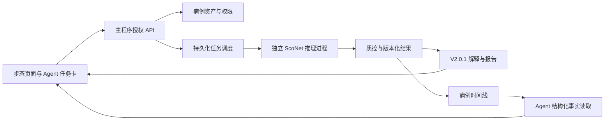

# 脊见智诊架构审查与 ScoNet V2.0.1 接入对齐

日期：2026-09-08。状态：代码审查与方案草案，待用户回答范围问题后收敛实施。

## 结论

项目已经具有影像推理、登录、病例档案、Agent 策略和报告的基础，适合增量升级。当前首要任务是统一病例归属、修正并发隔离、补齐可靠任务执行，再接入 ScoNet V2.0.1。建议采用模块化单体加独立推理进程，是否继续拆服务由部署规模决定。

步态接入应交付完整闭环：视频导入 → 选人和质控 → 推理 → 原片/Mask 复核 → 结构化结果 → 病例归档 → Agent 引用 → 报告。主项目目前还没有这条真实执行链。

本次没有修改业务代码、模型、权重或发布包；只新增这份审查与问题清单。未提交 Git、部署服务或调用外部模型。工作区已有大量未提交更改，后续实施应以当前工作区为基线，避免覆盖已完成工作。

## 审查范围与证据边界

- 阅读主入口、会话与认证、病例存储、Agent、报告服务、前端关键页面、部署与测试代码；并行审查了后端、前端和新步态工程。
- 使用应用工具读取用户指定任务的可返回记录。该任务最近两轮返回了空 items，因此最新版本事实同时依据本地 PROJECT_CONTEXT、发布清单、接入文档和源码核对；不声称已经取得那两轮全部原文。
- 知识工作流进行了任务相关检索，没有返回可用背景；未扫描完整知识库。
- 本轮运行主项目 `python -m unittest discover -s tests -p 'test_*.py' -q`：28 项通过，约 1.3 秒。
- 对 Agent 路由、长消息、中文检索和改写边界做了内存/模拟检查；对上传串病例路径做了纯内存双线程确定性验证。
- 本轮没有重新运行真实 GPU 视频、浏览器端到端、整包构建或真实病例测试。旧版本验收成绩是历史记录，不等同于本次重测。
- 未读取真实病例、私人视频或密钥内容。

## 当前真实架构

| 层 | 实际实现 | 接入影响 |
| --- | --- | --- |
| 产品页面 | `web/` 原生 HTML、JavaScript 全局对象与 DOM 渲染 | 产品页面并非 React；可先抽公共状态与组件，无需立即全站重写 |
| 站点外壳 | `site/` 的 React/Next/vinext 配置、代理与静态文件发布 | `site/public/` 是从 `web/` 同步的产物，需保留单一源码入口 |
| HTTP 后端 | `main.py` 内包含路由、认证中间件、推理、上传、任务和文件访问 | 边接入边按业务域拆模块，避免继续扩充单文件 |
| 影像运行时 | `SpineModel`、YOLO 模型、伪 CT 生成器、共享权重与推理锁 | 与病例数据对象分离，避免相互污染及重复加载 |
| 数据 | 内存 CaseRegistry、用户/旧个人档案/Agent 三套 SQLite 存储、JSON 批任务 | “用户、患者、病例、上传、分析任务”的主键语义尚未贯通 |
| Agent | 规则分流、关键词意图路由、工具提案、一次确认、SQLite 知识检索；DeepSeek 仅改写 | 当前属于受控流程协调器；尚没有完成真实视频任务的执行器 |
| 步态 V2.0.1 | 独立 ScoNetVideoApp，真实检测/跟踪/分割/分类与报告 | 复用推理与报告层，纳入主程序的授权、资产、任务与病例管理 |

主程序 FastAPI 声明版本和 pyproject 当前均为 2.0.0；步态应用 V2.0.1 是另一个组件版本。集成后应分别记录主程序、步态模块、模型、质控协议和报告 schema 的版本。

## 已确认或应优先处理的问题

P1：影响数据正确性、访问控制或核心任务；P2：影响稳定性、体验和维护成本。

| 优先级 | 发现 | 证据与验证 | 建议 |
| --- | --- | --- | --- |
| P1 | 同账号并发上传可能把 A 影像写入 B 病例 | `main.py:1389`、`mindspine/sessions.py:150`。纯内存双线程已复现 A 为空、B 收到 A 的路径 | 整个上传持有显式病例对象与请求级上下文；同病例修改采用锁或版本检查 |
| P1 | 多病例混用旧个人档案 | `main.py:127` 忽略 `_case_id`；`:2166` 按调用者 user_id 合并旧档案 | 建立 subject/case/asset/assessment 关系；只给明确对应的病例关联旧历史 |
| P1 | 登录 token 没有服务端到期与撤销 | `mindspine/sessions.py:56`，`main.py:2025` 注销仅删除 cookie；静态证据 | 独立认证 session，校验到期时间、退出撤销与登录限流 |
| P1 | 真实模式可能刷新成演示模式 | `web/personal-case.js:91` 移除 mode 参数；`web/spine-demo.js:150` 默认演示；静态控制流证据 | 统一路由上下文，保留 mode/case_id/assessment_id；真实和示例数据来源始终明确 |
| P1 | 视频页还没有真实任务 | `web/personal-app.js:419` 固定等待；`:429` 仅提交素材 metadata；`personal-workspace.html:108` 分析按钮禁用 | 由真实服务端上传、质控、任务、结果驱动界面，不把等待动画当处理进度 |
| P1 | 新步态不能靠启用工具开关运行 | `mindspine/spine_agent.py:1149` 只创建 assessment_jobs；现有提案未绑定 asset_id | 实现调度器、进度回写、结果验证与资产归属；工具启用须绑定可用执行器 |
| P1/P2 | 视频任务缺少持久调度与恢复语义 | `main.py:184` 内存线程池，`:1781` 配额检查与占位分离，`:1164` 重启将运行任务标失败 | 原子提交/领取、全局资源配额、取消/超时/重试；记录重启后是重跑还是仅恢复结果 |
| P1/P2 | 临时清理与持久化资产生命周期不一致 | `mindspine/sessions.py:198` 仅枚举内存会话；`main.py:296` 删除会话目录 | 资产数据库登记、明确保留期、后台回收；归档报告不得依赖即将清理的临时 URL |
| P2 | Agent 关键词路由误判且不理解否定 | `mindspine/spine_agent.py:1400`。实测“康复动作训练计划”和“不想分析视频”都提议视频工具 | 结构化意图、上下文和否定表达测试；行动提案验证输入是否齐备 |
| P2 | 长消息接口长度不一致 | `spine_agent.py:1080` 消息允许 1600 字；`:1261` 检索最多 400 字。401 字实测失败 | 消息与检索 query 分离；写用户消息前完成输入验证，避免产生半轮记录 |
| P2 | 中文检索未兑现完整检索契约 | `spine_agent.py:1260` 整句分词后逐行 count，无 audience/age 过滤，未使用已建 FTS 表 | 先建立中文 query 处理、适用人群和使用政策过滤及小型检索评测集，再决定向量方案 |
| P2 | 外部改写能覆盖真实状态 | `ai_report_service.py:281` 仅屏蔽少量词语。模拟“所有结果已完成，直接开始训练”被 accepted | 状态、数值、结果来源由固定结构渲染；模型只补解释，输出须与事实和行动约束一致 |
| P2 | Agent 审计链丢失工具步骤 | `spine_agent.py:1475` 截取 tool_trace[:4]，后来追加的动作/改写步骤丢失；内存实测确认 | 保存结构化 action/tool/result 事件；界面依据真实验证结果命名 |
| P2 | 任务确认后从真实页面消失 | `web/health-agent.js:121` 仅画 draft，completed 仅 demo；确认 token 仅内存 Map | 统一持久任务卡，展示 queued/running/completed/rejected/failed/cancelled 并提供结果入口 |
| P2 | 前端存在多套重复 Agent/报告/状态实现 | `web/personal-case.js` 和 `health-agent.js` 重复 Agent；`app.js:1566` 导出当前 X 光，档案只打印页面 | 抽共享 API client、病例上下文、任务与结果组件；分清单次步态报告和综合病例报告 |
| P2 | 离线界面依赖运行时 CDN | `web/personal-workspace.html:7`、`:8` 与 `web/styles.css:2` | 本地打包样式、字体和图标，断网进行实际界面验收 |
| P2 | 手机采集布局与权限未具备 | `personal-workspace.html:48` 固定 390px 侧栏；`main.py:275` camera=() | 如首版需要录制，增加窄屏步骤布局与按页面/来源限定的摄像头权限 |
| P2 | 启动加载、文档和 CI 与现状不完全一致 | `main.py:103` 导入即加载模型；README 的 .env 本机命令未加载 dotenv；当前 GitHub workflow 仅发布静态产物 | 统一 launcher、应用生命周期、脱敏启动诊断；CI 加关键后端/前端流程检查 |

补充维护点：`model.py` 有多组同名报告/字体辅助方法和两次 crop_rgb_image 定义，后定义覆盖前定义。应在保留行为的前提下删除失效实现，避免后续改错位置。文档中的 DeepSeek 默认版本也与当前源码不同，需随发布校对；本轮没有验证远程供应商能力。

## V2.0.1 接入边界

源工程：`C:/Users/MK2SG/Documents/ChatGPT/脊柱步态识别/ScoNetVideoApp/`。

最新 V2.0.1 是展示措辞更新，权重、三类分数、质控规则没有因这次更新改变。EXE 名仍为 `MindSpineScoNet_2.0_Windows_GPU.exe`，身份以 `releases/desktop/build_manifest.json` 为准。该版本约 3.16 GB；不能直接由文件名判断版本，也不应把整个 EXE 当 Python 依赖复制进主程序。

真实链路：RGB 视频 → YOLOX-X MOT17 → ByteTrack → PP-HumanSegV2-Mobile → 原生 Mask 对齐 → ScoNet。关键点、步态周期、左右侧运动学曲线和 Cobb 角不是当前模块输出，若需要应分别立项。

输入入口是 `sconet_video.pipeline.analyze_video(video_path, output_dir, model_dir, progress_callback=None, options=None)`。选项包括时间片段、target_track_id、device 和 research_demo。报告解释/导出层在推理之后仍需接入，不能只拿 pipeline 的基础字典就当作完成了 V2.0.1 全部体验。

已核对的接入细节：

- 主项目锁定 NumPy 2.2.6 / Torch 2.10.0 / TorchVision 0.25.0；步态应用使用 NumPy 1.26.4 / Torch 2.1.2 / TorchVision 0.16.2，OpenCV 等也不同。这是实际依赖版本冲突；首版应隔离 Python 运行环境，而不是合并 requirements。
- `reporting.prepare_report_view(job, cache)` 补齐 `report_view_version=2.0.1`、`original_report_sha256`、内嵌真实抽帧图片、`report_v2.json` 和 `report_v2.zip`；基础 pipeline 的 schema 仍为 `sconet_video_app_v1`。`server.py:570` 附近才附加 file_urls，集成时必须改成主程序鉴权 URL。
- 当前实现需要原训练权重、纯张量部署权重以及检测/分割模型和 manifest 成套迁移；不能只带分类 `.pt`。`pipeline.py:109` 和 `classifier.py:164` 体现双权重要求。
- 当前片段上限 45 秒，采样最多 15 fps，基本门槛含至少 60 有效 Mask、覆盖率至少 65%，另有歧义、贴边、人物尺寸及近静止等检查。这些是现有工程规则，不代表已决定适用于所有目标人群。
- 检测和分类可用 CUDA，分割使用 ONNXRuntime CPU；不能把选择 GPU 理解为所有阶段都在 GPU 上运行。
- `pipeline.py:109` 附近的共享模型锁不覆盖整段推理，frontend 还含共享 tracker ID 状态。应保持单进程内串行执行，或每个独立 Worker 隔离跟踪状态。
- 源工程 README 记录了学术用途限制；若用户目标含商业化，需单独核验具体来源与授权，本轮不据此停止研究/演示范围的方案工作。

必须保留：

- 选人歧义处理、质量阻断与人物重选重跑。
- 无损 Mask 数组用于推理；H.264 预览用于播放，两者用途分开。
- 原视频、跟踪/Mask 预览同步回看，以及现有三类模型分数。
- `prediction`、`raw_model_prediction`、`quality`、`analysis`、`runtime`、产物清单的语义。
- 权重、前处理、质控和报告版本来源；`report_v2` 与原报告的来源关系。
- 用户在 V2.0.1 已确认的简洁文案偏好：不恢复重复研究横幅、免责脚注和长解释段。详情采用按需展开，内部能力标志保留。

## 建议的接入架构（待定稿）

主程序继续负责登录、病例权限、资产访问和持久任务；步态进程负责模型运行。GPU 首版串行执行步态任务，跟踪器不能跨任务混用。是否与其他影像模型共享 GPU，需依据显存与同时使用需求设置总调度。

建议领域实体：

| 实体 | 职责 |
| --- | --- |
| subject | 被测者/患者身份；与登录账号区别 |
| case | 该被测者的某类随访或评估档案，具体含义由用户确认 |
| asset | 原片和派生产物、归属、哈希、保留策略 |
| job | 单次执行的输入、资源、状态、进度、失败原因与重试关系 |
| assessment | 不可静默覆盖的分析结果，关联模型、协议、质量和来源 |
| report | 基于固定 assessment 生成的报告版本 |
| agent_action | 用户意图和执行提案，绑定上述实际对象 |

建议 API 增量：病例下上传视频和创建步态任务、统一任务查询/取消、assessment 详情、授权产物访问、报告导出。已有 `/api/jobs/{job_id}`，独立应用也使用 `/api/jobs`；应通过适配层统一命名和 schema，避免直接挂载造成冲突。

任务状态至少区分 queued、running、completed、rejected、failed、cancelled。completed 表示本次执行完成；结果是否允许展示预测由质控和运行模式共同决定。rejected 需要给出具体的重拍/重选建议，不能和系统异常合并。

对重启的建议是先支持读取已有结果、识别中断、明确重跑；如果用户要求从中间帧继续，需额外保存跟踪/分割等检查点，不能仅恢复进度百分比。

这种重计算隔离思路与 [FastAPI 官方关于重后台计算的说明](https://fastapi.tiangolo.com/tutorial/background-tasks/#caveat)一致。SQLite 可用于单机首版；是否采用 WAL、写入串行或升级数据库取决于访问模式。WAL 仍存在单写者限制，参见 [SQLite 官方说明](https://www.sqlite.org/wal.html)。这些资料用于验证工程建议，不代表当前项目已具备相关能力。

## 建议实施与验收顺序

1. **基线与核心修复**：以当前工作区整理变更清单，修复并发串病例、真实/演示模式、病例映射和认证生命周期。验证跨账号、同账号多病例与并发上传。
2. **推理适配与任务闭环**：固定 V2.0.1 源版本和权重清单，隔离依赖，创建视频资产、任务状态和可追溯结果。验证缺权重、CPU/GPU、质控拒绝、错误与取消。
3. **步态页面与归档**：上传/选人/进度/原片和 Mask/三类分数/重跑/历史/报告。验证刷新、离开页面、程序重启后的约定行为。
4. **Agent 协作**：结构化提案绑定 asset_id；读取真实 assessment 并解释；支持缺输入追问、失败后的下一步、结果链接与复核。验证否定表达、混合意图和事实约束。
5. **交付**：根据用户选择制作 Windows 包或局域网服务，验收离线资源、启动诊断、模型清单、数据迁移与回退。训练提分/新模型研究不自动并入此阶段。

新步态同输入与现有参考的分数、Mask 应进行等价性核验；跨运行库或设备采用明确的容差，不能预先承诺所有 GPU 位级一致。历史记录中曾有 118 帧 Mask 一致和三类分数无差的验收，本轮未重跑该视频。

历史记录需精确区分：V2.0.0 曾进行真实 EXE 视频推理和 53 项回归；V2.0.1 有单独的界面、报告措辞及相关测试记录。不能将旧版 53 项回归或 42.29 秒运行时间写成这次接入后、或 V2.0.1 本轮重新获得的成绩。

## 对齐问题清单

用户可按编号简短回答，不确定项可写“按建议”。★项决定首轮实施边界；其余可以分轮收敛。已通过对话问答卡发送的题目与下列问题重合，不必重复回答。

### 目标与范围

1. ★ 下一次交付主要用于老师演示、课题答辩、学校试点，还是医生实际工作？
2. ★ 本轮先完成审查/问题对齐，还是边对齐边实施步态接入，或直接推进系统升级？
3. ★ 有明确的演示/试用日期吗？到那一天必须完成的三件事是什么？
4. ★ 主要被测人群是青少年、成人还是两者？两类流程是否分开？
5. 首要操作者是谁：学生本人、家长、筛查人员、医生还是研究者？
6. 你最不满意的三个现有操作/页面是什么？怎样改变才算解决？
7. ★ 已有 X 光、RGB、伪 CT、报告、个人档案哪些必须保留？哪些可降级为高级入口？
8. 首版固定当前模型与参数是否合适？提分、关键点、实时分析是否作为独立后续任务？

### 部署与资源

9. ★ 首要运行形态是带权重 Windows EXE、局域网服务器，还是公网 Web？
10. ★ 必须完全断网运行吗？Agent 无外部大模型时应保留哪些功能？
11. 最低目标电脑的 GPU、显存、内存、Windows 版本是什么？是否必须支持无独显？
12. 日视频量、同时登录人数、同时提交分析数大约是多少？
13. 典型视频分析等待多久可接受？排队多长时间需要提醒或拒绝？
14. 约数 GB 的交付体积是否可接受？偏好单 EXE、文件夹包还是安装程序？
15. 窗口关闭、退出登录、电脑重启时任务应继续、取消、标记中断还是自动重跑？

### 步态模块

16. ★ 首版输入只需上传已有视频，还是还需浏览器摄像头录制？
17. 需要单视频、批量视频、同一人的多个视角，还是同一视频内选择多个人分别处理？
18. 可规定的拍摄条件是什么：时长、方向、距离、清晰度、遮挡和单人取景？
19. ★ 是否完整保留 V2.0.1 的选人、原片/Mask、质控、重跑、历史、示例和报告？如裁剪，哪些必选？
20. 人物选择默认自动，还是分析前始终人工确认？歧义时是否停止并要求选择？
21. 原片与 Mask 是否需要同步拖动、逐帧、慢放、循环和缩放？最重要的两个操作是什么？
22. 首屏优先看三类分数、质量、人物复核还是中文摘要？高级技术信息哪些要展开可见？
23. 低质量时是只显示重拍原因，还是也允许专业人员查看被阻断的中间产物？
24. 同一视频重跑是保留所有结果，还是标记一个当前采用版本？是否需要对比参数？
25. 除已有三类分数外，是否期待关键点/周期/对称性等新测量？若期待，是否接受单独研发验收？

### 病例与数据

26. ★ “病例”在你的业务中指一个人、一次就诊还是一次检查？同人多次检查如何归档？
27. 一个账号是否管理多个学生/患者/家属？是否需要医生、患者、研究者等不同权限？
28. ★ 旧影像与个人历史怎样映射到新病例？由原账号默认档案承接，还是提供一次整理入口？
29. 结果完成后自动归档，还是先复核再归档？允许备注、更正和选用哪次结果吗？
30. 原视频、Mask 数组、预览视频、模型结果、报告分别保存多久？是否可只保留派生结果？
31. 删除一次检查时，是否连同视频、报告和 Agent 引用删除？需要回收站或审计记录吗？
32. 是否需要病例共享、批量导出、备份恢复和跨电脑迁移？哪项首版必须有？
33. 纵向随访要比较什么？不同版本、不同采集协议的结果是否只并排显示？

### Agent 与知识

34. ★ Agent 只解释结果，还是能创建分析、追踪任务、归档、生成报告并安排复核？
35. 用户说“帮我分析这段视频”后，材料齐全时能否直接提交？哪些操作必须再次确认？
36. Agent 是否要支持多步流程，例如补问采集信息→运行→解释→写病例→生成报告？
37. 同一病例的历史对话应长期记住哪些内容：目标、偏好、检查记录还是操作历史？
38. 哪些知识来源可用于回答，谁负责审核和更新？是否有老师认可的材料与典型问答？
39. 允许外部模型接收哪些结构化事实？建议首版继续使用去标识化摘要，不自动扩大到原视频。
40. 外部模型不可用或超时时，最小可接受体验是什么？是否需要流式回复和可见工具进度？
41. 多模态结果有矛盾时，产品应如何展示、交由谁复核？是否需要专门的证据对照页？

### 视觉、报告与验收

42. ★ 保留深色 V2.0.1、医生深色/个人浅色双模式，还是全站统一重设计？
43. 主导航是否可收敛为“总览、评估、病例、Agent、报告”？医生与个人是否共用同一外壳？
44. 手机是拍摄端、完整分析端还是只看报告？首版需要适配哪些屏幕和输入方式？
45. ★ 导出需要独立步态 PDF、综合病例 PDF、HTML、JSON/CSV、视频或 ZIP 中哪些？
46. 报告是否需要医院/学校名称、老师/医生复核信息、签名位置和固定模板？
47. ★ 演示入口如何保留？正式使用是否登录后默认真实数据，示例需要显式进入？
48. 最终由谁验收？能否提供授权样例和典型失败场景，以哪些准确性、时延、稳定性和操作体验标准决定完成？

## 建议默认值（尚未作为用户决定执行）

保留已有核心功能和数据；固定当前 V2.0.1 模型；先做上传视频闭环；在主程序统一病例、任务和报告；GPU 串行、CPU 可用时降级；Agent 从结构化结果解释与工具协调开始；沿用简洁文案；先修状态和数据正确性，再做大范围视觉或框架迁移。部署目标、人群和旧数据映射需依据用户回答确认。
